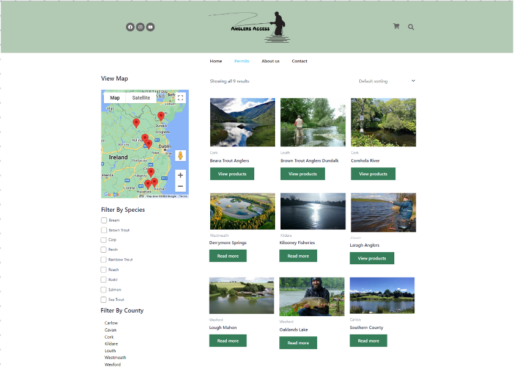
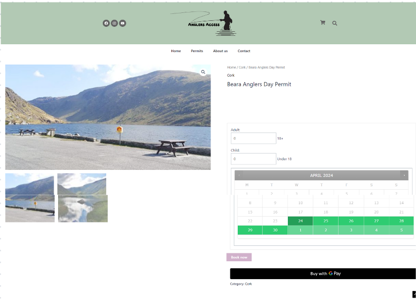
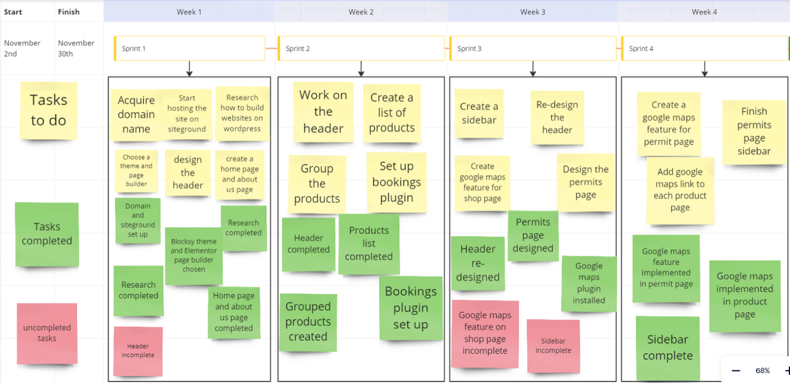

# 🎣 Anglers Access

**An online marketplace for Irish fishing permits.** Anglers find fisheries on a map, filter by county or species, see where to park and get to the water, and book a day or weekly permit online.

👉 **Project site: https://c20744531.github.io/AnglersAccess/**

## The problem

Ireland has roughly 127 fisheries, but only 42 have a website and only 10 sell permits online. Most clubs sell over the phone or in a local shop, the information is often out of date, and younger anglers are drifting away from the sport.

## What I did

- **Research:** literature review on e-ticketing adoption (TRA, TPB, TAM), market analysis, and a survey of 74 anglers analysed with pivot tables
- **Outreach:** contacted 51 fisheries and signed up 9 clubs across 7 counties
- **Build:** WordPress + WooCommerce site built in four Agile sprints, with WooCommerce Bookings, Google Maps, Stripe split payments and AutomateWoo booking emails
- **Evaluation:** user survey plus interviews with fishery reps and Inland Fisheries Ireland

## Key results

| | |
|---|---|
| Anglers who prefer to book online | **61%** |
| Say fisheries need a bigger online presence | **74%** |
| Testers who strongly agreed they'd use it | **86%** |
| Rating from fishery representatives | **9/10** |

## Screenshots

| Booking page | Sprint board |
|---|---|
|  |  |

## Credits

Final-year thesis, BSc E-Commerce in Retailing, TU Dublin (2024). Built as a team project with Luke Watson and Lawrence Proseckin, supervised by Dr Wael Rashwan.
